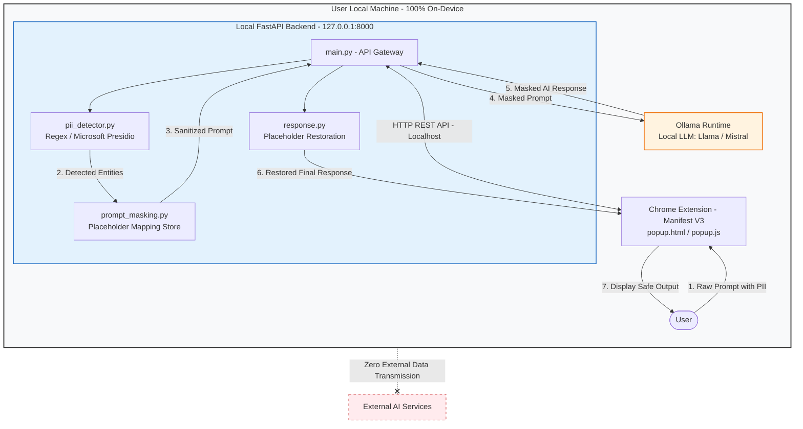

# Local AI Privacy Protector

**A Local-First AI Prompt Privacy Protection System Using Chrome Extensions and On-Device LLMs.**    

**Category of Topic :** Data Mining and Artificial Intelligence Approaches.


## Description

Local AI Privacy Protector is a privacy-focused Chrome extension designed to detect and protect sensitive information in AI prompts before processing.

The system uses Personally Identifiable Information (PII) detection and automated prompt masking to identify sensitive data, such as names, email addresses, and phone numbers. It replaces detected information with placeholders and processes the sanitized prompts using a locally hosted Large Language Model (LLM) through Ollama.

By keeping prompt processing and AI inference on the user's device, the project aims to reduce sensitive data exposure to external AI services and improve user control over personal information.

## Project Timeline

| Phase | Activities |Timeline
|---|---|---|
| Design | Privacy assessment and system architecture | Oct 20 ~ Nov 6 |
| Development | Chrome extension, PII detection, and Ollama integration | Nov 7 ~ Nov 16 |
| Testing | Detection accuracy and network verification | Nov 17 ~ Nov 28 |
| Evaluation | Performance, response quality, and usability | Nov 29 ~ Dec 4 |
| Finalization | Documentation and project presentation |Dec 5 ~ Dec 10|

## Key Features

- **PII Detection:** Identify sensitive information using regular expressions and/or Microsoft Presidio.
- **Automatic Prompt Masking:** Replace detected sensitive information with unique placeholders.
- **User Privacy Controls:** Allow users to review and manage detected information.
- **Local AI Processing:** Generate responses using locally hosted LLMs through Ollama.
- **Response Restoration:** Restore original information in AI-generated responses when appropriate.
- **Privacy Protection:** Minimize external data transmission through local-first processing.

## Technology Stack

| Component | Technology |
|---|---|
| Browser Extension | Chrome Extension Manifest V3 |
| Frontend | HTML, CSS, JavaScript |
| Backend | Python, FastAPI |
| PII Detection | Regex, Microsoft Presidio |
| AI Runtime | Ollama |
| Local LLM | Llama / Mistral |
| Testing | Python, Chrome DevTools, Wireshark |
| Version Control | Git, GitHub |

## Prototype

**Figma:** [Insert Figma Prototype Link]

**Screenshots:** [Insert Screenshots or Demo GIF]

## System Architecture



All prompt processing and AI inference are intended to remain on the local machine without requiring external AI APIs.

## System Architecture

```text
User Prompt
    |
Chrome Extension
    |
PII Detection
    |
Prompt Masking
    |
Local FastAPI Backend
    |
Ollama - Local LLM
    |
AI Response
    |
Response Restoration
    |
   User   
```

All prompt processing and AI inference are intended to remain on the local machine without requiring external AI APIs.

## Project Structure

```text
Local-AI-Privacy-Protector/
|
|-- extension/                  # Chrome extension (frontend)
|   |-- manifest.json
|   |-- popup.html
|   |-- popup.css
|   |-- popup.js
|
|-- backend/                    # Local backend
|   |-- main.py
|   |-- pii_detector.py
|   |-- prompt_masking.py
|   |-- response.py
|
|-- test/                       # Testing and evaluation
|   |-- test_pii.py
|   |-- test_masking.py
|
|-- README.md                   # Documentation and Report
|-- requirements.txt
|-- Final_report.pdf
```


## Installation and Setup

### 1. Clone the Repository

```bash
git clone https://github.com/YOUR-USERNAME/Local-AI-Privacy-Protector.git

cd Local-AI-Privacy-Protector
```

### 2. Set Up the Python Environment

```bash
python -m venv .venv
```

Activate the environment:

**Windows:**
```powershell
.venv\Scripts\activate
```

**macOS / Linux:**
```bash
source .venv/bin/activate
```

### 3. Install Dependencies

```bash
pip install -r requirements.txt
```

### 4. Install Ollama

Download Ollama:

https://ollama.com/

Download a supported local model:

```bash
ollama pull llama3.2:3b
```

Start the Ollama service and verify that the model is available.

### 5. Start the Local Backend

```bash
uvicorn main:app --reload --host 127.0.0.1 --port 8000
```

### 6. Load the Chrome Extension

1. Open Google Chrome.
2. Navigate to `chrome://extensions`.
3. Enable **Developer mode**.
4. Select **Load unpacked**.
5. Select the `extension/` directory.
6. Open the extension and start testing.

## Testing and Evaluation

The prototype will be evaluated using synthetic prompts containing different categories of sensitive information.

| Evaluation Area | Measurement |
|---|---|
| PII Detection | Precision, Recall, F1-score |
| Privacy Protection | External network transmission |
| Performance | Processing and inference latency |
| Response Quality | Usefulness of masked-prompt responses |
| Usability | Ease of use and clarity of privacy controls |


## Privacy and Security Considerations


**Note:** Local processing reduces exposure to external services but does not automatically guarantee complete security or legal compliance.


